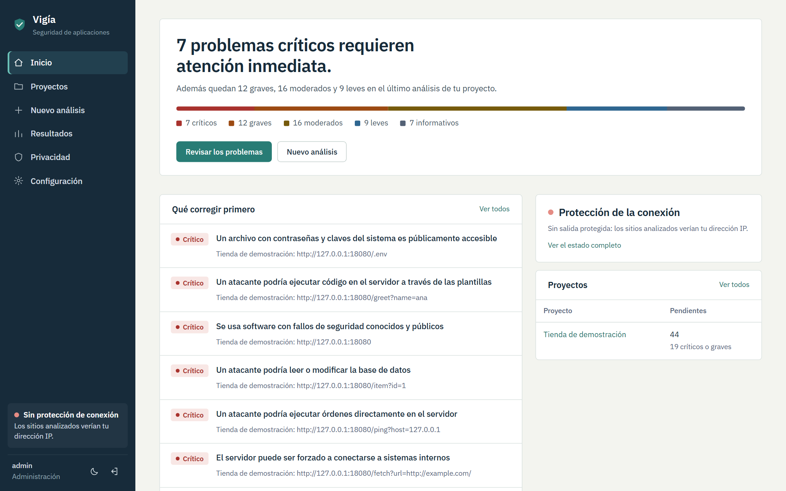
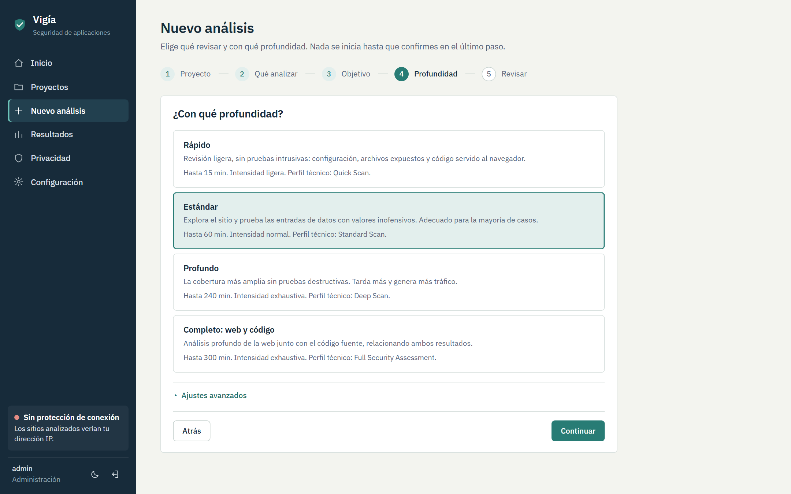
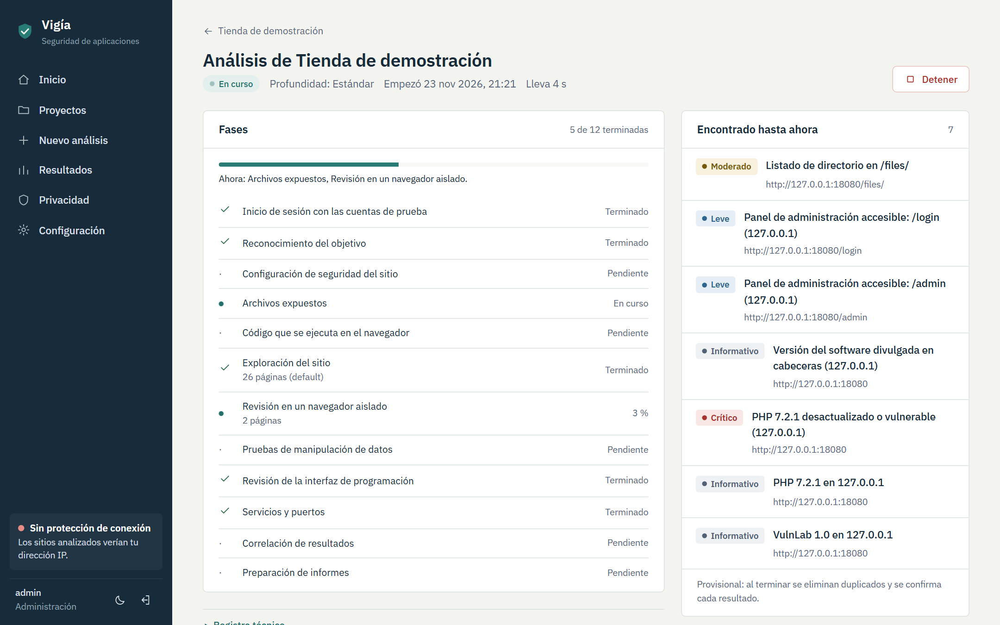
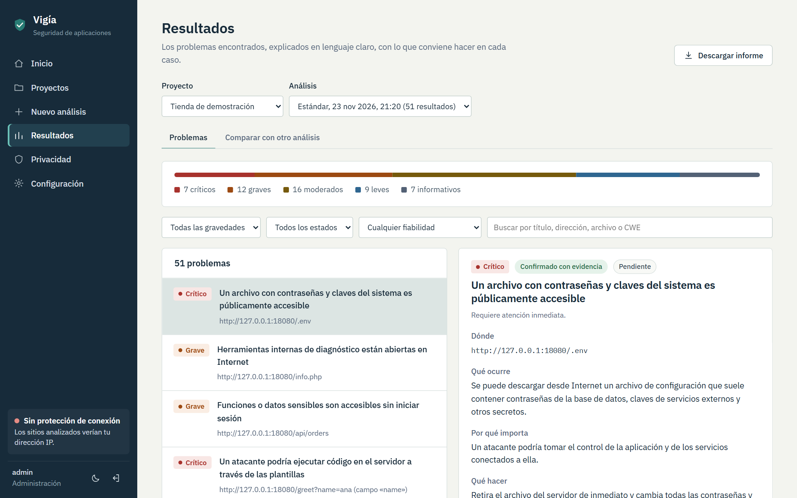
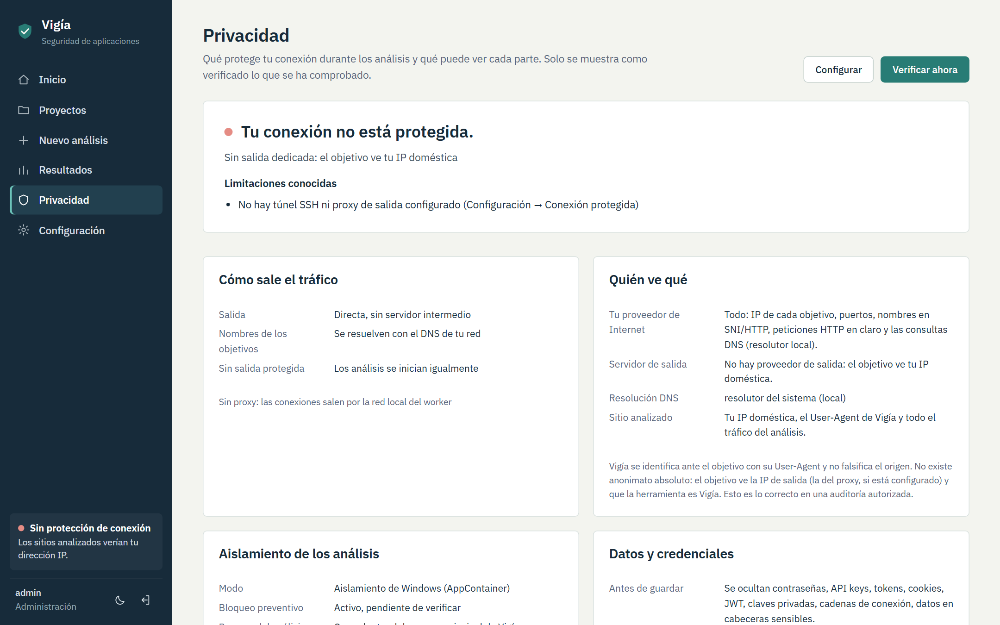
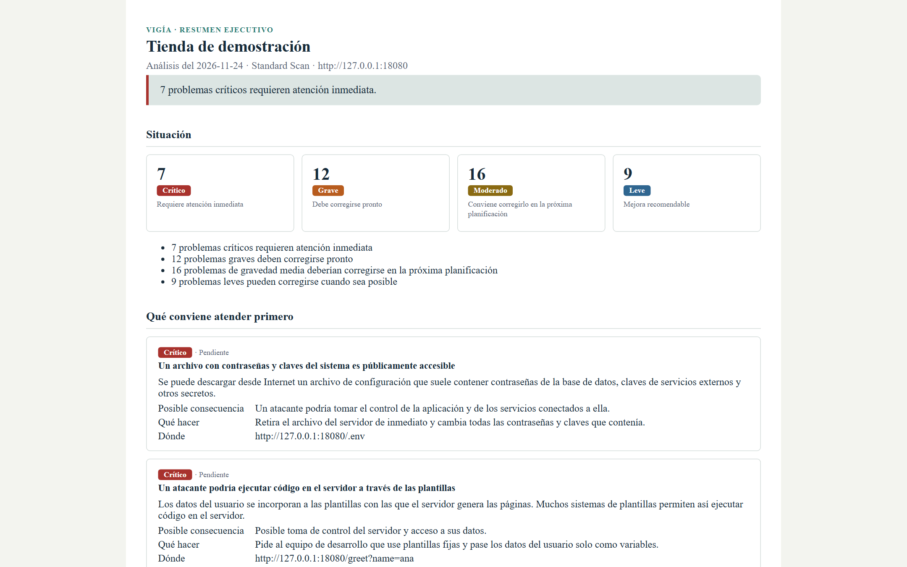
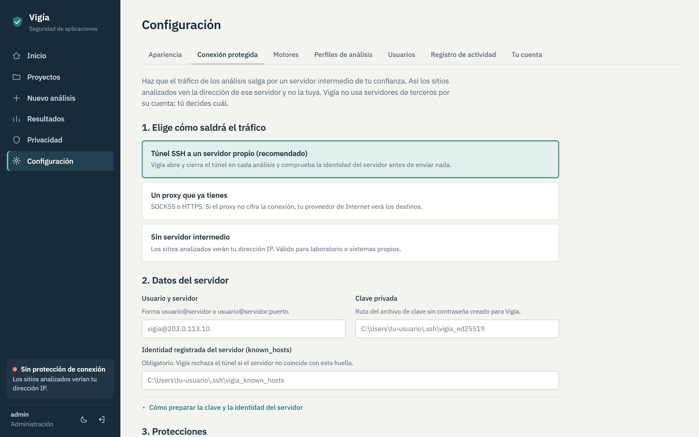

<h1 align="center">Vigía</h1>

<b>Análisis de seguridad de aplicaciones, webs, APIs e infraestructura, dentro de un alcance autorizado.</b> 
Explica cada problema en lenguaje claro y protege la conexión de quien analiza.

> **Uso exclusivamente autorizado.** Vigía solo debe usarse sobre sistemas propios o con permiso expreso de su titular. Antes de cualquier análisis activo exige registrar las direcciones permitidas y la referencia de esa autorización, y deja constancia de cada acción.

## Qué es

Vigía es una herramienta de análisis de seguridad que se ejecuta en tu propio equipo. Revisa aplicaciones web, APIs, código fuente e infraestructura en busca de vulnerabilidades, errores de configuración y riesgos, **antes de que alguien pueda aprovecharlos**. Cada resultado indica qué ocurre, por qué importa y qué hacer, con los detalles técnicos a un clic.

## Qué permite hacer

- **Webs y APIs.** Exploración del sitio, configuración de seguridad (cabeceras, cookies, TLS), archivos expuestos, pruebas de inyección con valores inofensivos y comprobaciones del OWASP API Top 10, incluido el acceso a datos de otro usuario cuando se aportan cuentas de prueba.
- **Código fuente.** Revisión sin ejecutarlo: fallos habituales, contraseñas escritas en el código, dependencias con vulnerabilidades conocidas y configuración de infraestructura (Docker, Kubernetes, Terraform).
- **Reconocimiento e infraestructura.** Servicios y puertos accesibles, certificados, bases de datos y paneles expuestos.
- **Correlación y prioridad.** Elimina duplicados, calcula la gravedad (CVSS 3.1), detecta problemas que se combinan en un ataque mayor y ordena qué corregir primero. Solo marca un resultado como confirmado si tiene evidencia propia.
- **Aislamiento por análisis.** En Windows, cada análisis se ejecuta en un contenedor propio (AppContainer) con su base de datos temporal, sin acceso a otros proyectos ni a las claves.
- **Protección de la conexión.** El tráfico de los análisis puede salir por un **túnel SSH** hacia un servidor tuyo, con la identidad del servidor verificada, resolución DNS remota y sin salida directa de reserva. El panel de Privacidad muestra solo lo que se ha comprobado.
- **Informes.** Ejecutivo (para dirección, en lenguaje claro) y técnico, en HTML y PDF, además de CSV, JSON e inventario de componentes (SBOM).

## Cómo funciona

1. **Creas un proyecto** para la aplicación que quieres revisar.
2. **Defines el alcance**: las direcciones que puedes analizar y la referencia del permiso del titular.
3. **Configuras el análisis** en un asistente: qué analizar y con qué profundidad.
4. **Vigía ejecuta las comprobaciones** con sus módulos propios y, si están instalados, con motores externos, mostrando el progreso real.
5. **Correlaciona los resultados** y los prioriza.
6. **Presenta los problemas y las recomendaciones**, y permite seguir su corrección.
7. **Genera los informes** para dirección y para el equipo técnico.

## Capturas

Capturas reales de la aplicación con datos ficticios de laboratorio: una aplicación vulnerable de prueba que se ejecuta en el mismo equipo.

| | |
|---|---|
|  **Asistente de análisis** |  **Progreso real del análisis** |
|  **Resultados en lenguaje claro** |  **Privacidad y protección de la conexión** |
|  **Informe ejecutivo** |  **Configuración guiada del túnel SSH** |

## Requisitos (Windows)

- Windows 10 u 11 de 64 bits. **No necesita permisos de administrador.**
- [Python](https://www.python.org/downloads/) 3.11 o superior (probado con 3.12), con la opción «Add python.exe to PATH».
- [Node.js](https://nodejs.org) LTS, solo la primera vez, para compilar la interfaz.
- Conexión a Internet la primera vez, para descargar las dependencias con sus versiones fijadas.
- Opcional:
  - el cliente OpenSSH de Windows, para el túnel SSH;
  - el navegador aislado y los motores externos, que se instalan con `.venv\Scripts\python -m vigia.cli tools install` desde la carpeta `backend`.

## Inicio rápido

1. Descarga o clona este repositorio.
2. Haz doble clic en **`INICIAR_VIGIA.bat`**. La primera vez:
   - crea el entorno de Python;
   - instala las dependencias comprobando sus hashes;
   - compila la interfaz;
   - te pide crear la cuenta de administración.
3. Vigía se abre en tu navegador en `http://127.0.0.1:8600`. Solo es accesible desde tu equipo.
4. Para detenerlo, pulsa `Ctrl+C` en su ventana o ejecuta **`DETENER_VIGIA.bat`**.

`INICIAR_VIGIA.bat` no inicia ningún análisis ni cambia la configuración de privacidad. Si Vigía ya está en marcha, no abre una segunda instancia.

## Estado del proyecto

Vigía está en desarrollo activo. La versión actual funciona en Windows y supera su batería de pruebas automatizadas: unitarias, de integración, de privacidad de red, análisis reales contra un laboratorio local y pruebas de la interfaz con un navegador real. **Aún no ha pasado una revisión de seguridad independiente**, así que no se recomienda para entornos de producción.

## Limitaciones conocidas

- La versión actual está enfocada en Windows. **Linux y Docker están pendientes de validación.**
- **ZAP y Opengrep** no pueden ejecutarse dentro del aislamiento de Windows sin permisos de administrador. Cuando el aislamiento es obligatorio se bloquean y Vigía lo indica.
- Con una salida protegida, **Nuclei, Nmap y testssl.sh** se bloquean porque parte de su tráfico no respeta el túnel. Vigía cubre esas áreas con sus módulos propios.
- El **túnel SSH** se ha validado con un servidor SSH en el propio equipo. Falta validarlo con un servidor remoto a través de Internet.
- El bloqueo de **IPv6 y UDP** dentro del aislamiento necesita validación adicional con tráfico real.
- **No hay anonimato.** El sitio analizado ve la dirección de salida y que la herramienta es Vigía. Sin salida protegida, ve tu dirección IP.
- Requiere una **revisión de seguridad independiente** antes de recomendar su uso en producción.

## Licencia

Vigía es **código fuente disponible bajo condiciones de uso no comercial** (ver [`LICENSE`](LICENSE)). No es una licencia de código abierto aprobada por la OSI.

- Puedes consultar y estudiar el código, y usarlo, modificarlo y compartirlo sin fines comerciales, conservando la licencia y la autoría.
- **No** puedes venderlo, ofrecerlo como servicio comercial, incorporarlo a productos comerciales ni usarlo con fines comerciales sin autorización previa y por escrito del titular.
- Para solicitar una licencia comercial, contacta con el titular a través de su perfil de GitHub ([@jhosMQZ](https://github.com/jhosMQZ)) o abre un *issue* titulado «Solicitud de licencia comercial».

Las dependencias y los motores externos tienen sus propias licencias.
